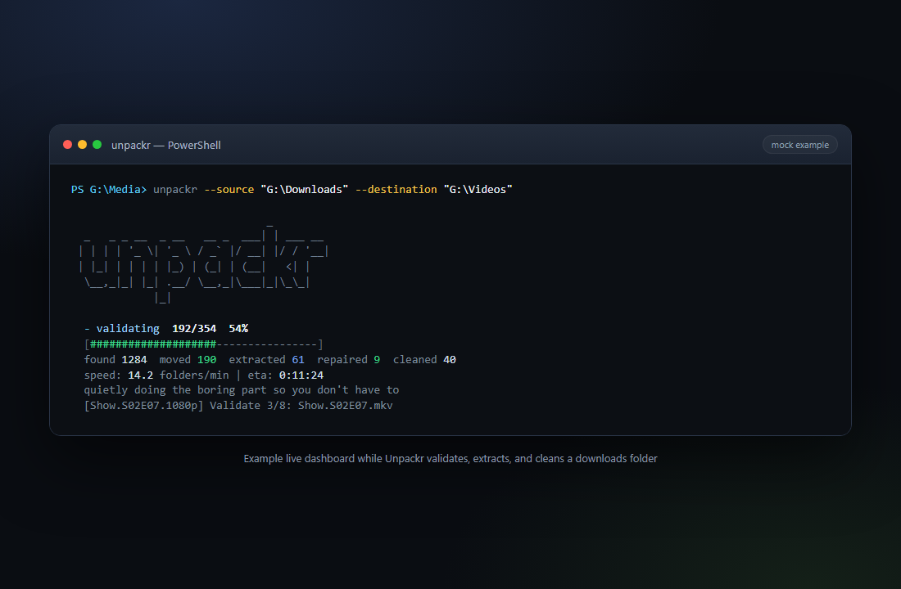

License: Apache 2.0 + Commons Clause (see [`LICENSE`](LICENSE))

Personal/research/sharing use free.

Commercial/enterprise products require separate license from Nick Seal.

# Unpackr

**Version 1.4.0** · August 2026

Unpackr turns a messy downloads folder (Usenet, torrents, whatever landed there) into a clean one. It repairs and unpacks archives, checks every video, moves the good ones to your library, keeps the music, photos and documents it finds, and **deletes everything else**. Deleting the junk is the point. It runs on **Windows, Linux, and macOS**.

Point it at a downloads folder, not at folders you curate by hand. Run it when you are ready to clean: a manual run treats anything unfinished (`.part`, `.!qB`, half-written files, damaged downloads) as junk. The unattended service is the exception and waits for downloads to finish.



*Example dashboard mid-run: progress, stats, current folder action, and status line. Paths and counts are illustrative.*

## What It Does

- **Keeps** videos that play (moved to the destination, renamed sensibly), music, photo and document collections, and anything it does not recognise.
- **Repairs and unpacks** RAR, 7z and zip sets, using PAR2 to fix damaged or obfuscated (renamed) volumes.
- **Deletes** samples, previews, trailers, damaged or truncated videos, unfinished downloads, archive volumes after a clean extraction, `.par2`/`.nfo`/`.sfv` and tracker spam, bait executables, and the folders left empty.
- **Undo is one command away**: removals go to a quarantine folder for 14 days by default (`unpackr restore latest`). Use `--dry-run` to see the plan first.

## Requirements

- **OS:** Windows, Linux, or macOS
- Python `3.11+`
- Required: [7-Zip](https://www.7-zip.org/) 22.0+ (`7zz` or `7z` on PATH; the old `p7zip` 16.02 is too old)
- Recommended: [par2cmdline](https://github.com/Parchive/par2cmdline), [ffmpeg](https://ffmpeg.org/)

Minimum supported versions:
- `7z` / `7zz`: `22.0+` (required)
- `par2`: `0.8.1+` (recommended)
- `ffmpeg`: `4.4+` (recommended)

Package-manager examples:

```bash
# Debian / Ubuntu
sudo apt install 7zip par2 ffmpeg   # Debian 12+, Ubuntu 24.04+

# Fedora
sudo dnf install 7zip par2cmdline ffmpeg

# Arch / Manjaro / Omarchy
sudo pacman -S 7zip par2cmdline ffmpeg

# macOS (Homebrew)
brew install sevenzip par2 ffmpeg   # provides 7zz
```

Windows: install [7-Zip](https://www.7-zip.org/), then put `par2` and `ffmpeg` on `PATH` (or set absolute paths in config `tool_paths`).

No root access: the official static `7zz` from [7-zip.org](https://www.7-zip.org/download.html) runs from any folder; set `"tool_paths": {"7z": "/path/to/7zz"}` in your config.

Archives: RAR (single, `.partNN.rar`, `.rar` + `.rNN`), 7z (single and `.7z.NNN`) and ZIP (single and spanned `.zNN` + `.zip`) are extracted.

Logs go to a per-user folder (`~/.local/state/unpackr/logs` on Linux, `~/Library/Logs/unpackr/logs` on macOS, `%LOCALAPPDATA%\unpackr\logs` on Windows) unless `log_folder` is an absolute path. A missing destination folder is created on a live run when its parent exists.

## Install

```bash
python -m pip install .
unpackr --help
unpackr-doctor
```

Run `unpackr-doctor` before live processing and resolve blocking issues first.

Developer quality tooling:

```bash
python -m pip install -e .[dev]
pre-commit install
pre-commit run --all-files
```

Current engineering baseline:
- full regression suite required to pass
- `80%` minimum coverage enforced in CI
- stricter Pyright tier on `core/config.py`, `core/file_handler.py`, and `core/safety_invariants.py`
- enforced local + CI gate via `ruff`, `mypy`, `pyright`, `bandit`, `pytest`, coverage, and `pre-commit`

## Quick Start

```bash
# Preview only (no file changes)
unpackr --source "~/Downloads" --destination "~/Videos" --dry-run

# Show plan and exit
unpackr --source "~/Downloads" --destination "~/Videos" --show-plan

# Live run
unpackr --source "~/Downloads" --destination "~/Videos"

# Resume after an interrupted live run
unpackr --source "~/Downloads" --destination "~/Videos" --resume
```

On Windows, drive-letter paths work the same way:

```powershell
unpackr --source "G:\Downloads" --destination "G:\Videos" --dry-run
```

The option is spelled `--destination`. The common misspelling `--destinantion` is accepted for compatibility, but scripts should use the canonical spelling.

Positional paths are also supported:

```bash
unpackr "~/Downloads" "~/Videos"
```

Source and destination must be provided together. Incomplete or conflicting path arguments fail with a usage error instead of falling into interactive mode.

If the installed launcher is unavailable, run the same command as `python -m unpackr ...` from the repository checkout, then reinstall with `python -m pip install .`.

## Running Unattended

On Linux with a systemd user session (most desktops, including Omarchy and other Hyprland setups), Unpackr can keep a downloads folder clean on its own:

```bash
unpackr service install --source "~/Downloads" --destination "~/Videos" --every 15m --on-change
unpackr service status
unpackr service uninstall --source "~/Downloads"
```

`install` shows the units it will write to `~/.config/systemd/user/` and enables them only after you confirm (`--yes` skips the prompt). The timer runs every `--every`; `--on-change` also runs when the top level of the source folder changes. `uninstall` disables the units and removes every file `install` wrote. Logs: `journalctl --user -u unpackr-<id>.service`, plus the usual log files under `~/.local/state/unpackr/logs`. A desktop notification (`notify-send`) is shown when a run moved something or needs attention; pass `--no-notify` to turn it off.

For cron, launchd or Task Scheduler, run `unpackr --unattended --source ... --destination ...` yourself. `--unattended` turns off animation, the countdown and prompts and prints one line per folder. It also takes a lock so overlapping runs on the same source exit cleanly, and, unlike a manual run, leaves unfinished downloads alone: releases with `.part`/`.!qB` files and anything changed in the last `settle_minutes` (default 2) are picked up by a later run. Add `--notify` for the desktop notification.

## Safety

Unpackr deletes files; that is its job. The safeguards are there so it never deletes the *good* file:

- Removals are reversible by default: they go to `<source>/.unpackr-quarantine/<run_id>/` for 14 days. Undo a run with `unpackr restore latest --source "~/Downloads"`, list runs with `unpackr runs --source "~/Downloads"`, or set `delete_mode` to `trash` or `permanent`.
- Archive volumes are only removed after their set extracted cleanly (7-Zip checks every file's CRC). A set that is incomplete, password-protected or blocked is kept and listed under NEEDS ATTENTION.
- Damaged downloads are removed like any other junk and listed under DAMAGED, RE-DOWNLOAD.
- Releases with executables or shortcuts are treated as bait: nothing from them is moved.
- `Ctrl+C` finishes the current step and stops.

Policy details and limits: [docs/SAFETY.md](docs/SAFETY.md)

## Legal And Compliance Notice

Only use Unpackr on files you are allowed to handle.

You are responsible for following the laws, licenses, and rules that apply to your setup (including copyright, privacy, and retention requirements).

Unpackr moves files and removes files (to its quarantine by default, or permanently when configured). You are responsible for backups and for reviewing planned actions before live use.

This project is a technical tool, not legal advice, and is provided "as is." The license terms are summarized at the top of this README, in [`LICENSE`](LICENSE), and in the package metadata.

## Tooling And Exit Codes

- `unpackr`: processing pipeline
- `unpackr-doctor`: environment and dependency checks
- `vhealth`: post-run video health checks (Windows / Linux / macOS; prefers `ffmpeg`). Without a terminal it answers delete prompts with No; use `--yes` or `--no` to decide up front, `--json` for a machine summary, `--no-color` for plain output
- Quality gate: `ruff`, `mypy`, `pyright`, `bandit`, `pytest`, `coverage`, `pre-commit`

Exit semantics:
- `unpackr-doctor`: `0` ready, `1` blocked
- `unpackr`: non-zero on validation/setup/processing failures (`3` when finished with items needing attention); `--json` emits a run summary with one item per file decision, and `--report FILE` writes them as JSON Lines
- `vhealth`: non-zero on invalid input/runtime errors (`vhealth --version` for package version)

Contracts: [Exit Codes](docs/EXIT_CODES.md) · [Doctor JSON](docs/DOCTOR_JSON.md) · [Preservation](docs/PRESERVATION.md) · [Benchmarks](docs/BENCHMARKS.md)

## Documentation

Detailed documentation is in [`docs/`](docs/README.md).

- [Docs Index](docs/README.md)
- [Roadmap](ROADMAP.md)
- [Platforms (Windows / Linux / macOS)](docs/PLATFORMS.md)
- [Configuration](docs/CONFIGURATION.md)
- [Safety](docs/SAFETY.md)
- [CLI Presentation](docs/CLI_PRESENTATION.md)
- [Troubleshooting](docs/TROUBLESHOOTING.md)
- [Technical Notes](docs/TECHNICAL.md)
- [Quality Gates](docs/QUALITY.md)
- [Build And Install](docs/BUILD.md)
- [Changelog](docs/CHANGELOG.md)
